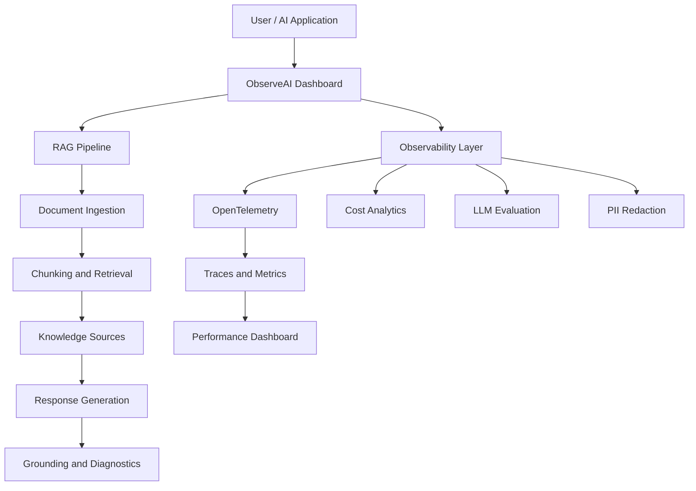

# ObserveAI — LLM Observability & RAG Reliability Platform

**A unified platform for monitoring, evaluating, and improving the reliability, performance, and cost efficiency of LLM-powered applications.**

<p align="center">
  
  
  
  
</p>

## Overview

ObserveAI is an LLM observability platform designed to provide end-to-end visibility into AI application performance, retrieval-augmented generation (RAG) workflows, model execution, and operational costs.

The platform brings monitoring, distributed tracing, document intelligence, response evaluation, and privacy-oriented data handling into a centralized dashboard. It helps developers investigate performance bottlenecks, analyze retrieved context, monitor request failures, and understand the behavior of LLM-powered systems.

## Key Features

### 1. Observability Dashboard
- Monitor total requests, average latency, P95 latency, error rate, and throughput.
- Visualize latency trends across configurable time ranges.
- Track estimated inference costs.
- Generate demonstration traffic for testing monitoring workflows.

### 2. RAG Playground and Document Intelligence
- Upload and process PDF and TXT documents.
- Select knowledge-base, uploaded-document, or combined retrieval sources.
- Inspect document processing status and chunk information.
- Submit natural-language queries against available knowledge sources.
- Examine retrieved passages and response-grounding information.
- Support extractive responses when a generative provider is not configured.

### 3. Distributed Tracing
- Inspect individual requests and execution traces.
- Analyze model execution duration and request status.
- Identify slow pipeline stages and potential retrieval bottlenecks.
- Investigate failures and latency variations.

### 4. LLM Evaluation
- Provide an interface for LLM-as-a-judge evaluation workflows.
- Support response-quality and grounding analysis.
- Enable systematic inspection of AI-generated outputs.

### 5. Cost and Performance Analytics
- Track token consumption and estimated inference expenditure.
- Monitor request latency and throughput.
- Analyze operational metrics to identify optimization opportunities.

### 6. Alerts and Configuration
- Centralize monitoring alerts and application settings.
- Support configuration of relevant AI-provider integrations.
- Provide visibility into operational health.

### 7. Data Privacy and Telemetry
- Incorporate PII redaction into the data-handling workflow.
- Integrate OpenTelemetry for instrumentation and tracing.
- Support privacy-conscious storage and operational diagnostics.

## Screenshots

### Observability Dashboard

Monitor request volume, latency percentiles, errors, throughput, estimated costs, and historical performance trends.


### RAG Playground

Upload organizational documents, configure retrieval sources, and inspect document readiness.


### Distributed Tracing

Review recent requests, execution status, model information, and processing durations.


### Response Grounding

Inspect retrieved passages, grounding indicators, and response-generation diagnostics.


### Latency Analytics

Compare average and P95 latency over time to identify performance spikes.


## Architecture

The platform combines document ingestion and retrieval with LLM processing and an observability layer.



*Conceptual architecture; component boundaries may vary with the implementation.*

## Technology Stack

| Technology | Purpose |
|---|---|
| OpenTelemetry | Instrumentation and distributed tracing |
| PostgreSQL | Relational data persistence |
| Drizzle ORM | Database access and schema management |
| Retrieval-Augmented Generation (RAG) | Document-grounded question answering |
| Large Language Models | Response generation and evaluation |
| PDF and TXT processing | Document ingestion |
| Data Loss Prevention (DLP) | Sensitive-data handling |

## Getting Started

### Prerequisites

Install the tools and services required by the repository:

- Git
- Node.js and npm, if applicable to the configured frontend
- PostgreSQL, if required for local deployment
- An LLM provider API key, if generative responses are enabled

### Clone the Repository

```bash
git clone https://github.com/dhanyaa07/ObserveAI-LLM-Observability-Platform.git
cd ObserveAI-LLM-Observability-Platform
```

### Install Dependencies

Use the package manager and installation commands specified by the project configuration. For an npm-based application:

```bash
npm install
```

### Configure Environment Variables

Create the required `.env` file and configure the database connection and AI-provider credentials using the variable names expected by the application.

Keep credentials out of source control and never commit secrets to the repository.

### Run the Application

Start the frontend and backend using the commands defined in the repository's configuration. For a Vite frontend, the development command is commonly:

```bash
npm run dev
```

Refer to the project's scripts and documentation for the exact startup procedure.

## Key Metrics

| Metric | Description |
|---|---|
| Total Requests | Requests recorded during the selected time range |
| Average Latency | Mean request-processing time |
| P95 Latency | 95th-percentile request latency |
| Error Rate | Percentage of failed requests |
| Estimated Cost | Approximate inference expenditure |
| Throughput | Request-processing rate |
| Trace Duration | Time taken by a request or pipeline stage |
| Grounding | Evidence linking responses to retrieved content |

## Security and Privacy

ObserveAI incorporates PII redaction and telemetry into its monitoring workflow. Production deployments should additionally implement appropriate authentication, authorization, secure credential management, access controls, and data-retention policies.

## Potential Enhancements

- Automated anomaly detection for latency, errors, and cost.
- Advanced RAG evaluation metrics, including context precision and recall.
- Prompt versioning and comparative evaluation.
- Configurable alerts and notification integrations.
- Multi-model benchmarking.
- Historical evaluation reports and performance comparisons.

## Author

**Dhanyashree N**

GitHub: [@dhanyaa07](https://github.com/dhanyaa07)

## License

Add a license file to the repository if you intend to distribute the project under an open-source license.

---

<p align="center">
  <strong>ObserveAI — Improving the reliability and transparency of AI systems.</strong>
</p>
