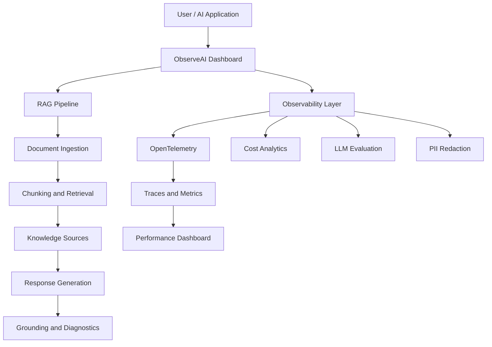

# ObserveAI — LLM Observability & RAG Reliability Platform

**A unified platform for monitoring, evaluating, and improving the reliability, performance, and cost efficiency of LLM-powered applications.**

<p align="center">
  
  
  
  
</p>

## Overview

ObserveAI is an LLM observability platform designed to provide visibility into AI application performance, retrieval-augmented generation (RAG) workflows, model execution, and operational costs.

The platform brings monitoring, distributed tracing, document intelligence, response evaluation, and privacy-oriented data handling into a centralized dashboard. It helps developers investigate performance bottlenecks, analyze retrieved context, monitor request failures, and understand the behavior of LLM-powered systems.

## Key Features

- **Observability dashboard:** Monitor request volume, average and P95 latency, error rate, throughput, and estimated inference cost.
- **RAG playground:** Upload PDF and TXT documents, select retrieval sources, submit natural-language queries, and inspect retrieved passages.
- **Distributed tracing:** Review request status, model information, execution durations, and pipeline bottlenecks.
- **LLM evaluation:** Provide an interface for inspecting response quality and grounding through LLM-as-a-judge workflows.
- **Cost and performance analytics:** Track token usage, estimated expenditure, and request performance.
- **Alerts and settings:** Centralize monitoring alerts and application configuration.
- **Privacy and telemetry:** Incorporate PII redaction and OpenTelemetry-based instrumentation.

## Screenshots

### Observability Dashboard

Monitor request volume, latency percentiles, errors, throughput, and estimated costs.


### Dashboard Metrics

Review service health and performance indicators across the selected time window.


### RAG Playground and Document Upload

Upload PDF or TXT documents, choose knowledge sources, and inspect document processing status.


### Distributed Tracing

Inspect recent requests, model execution details, request status, and processing duration.


### RAG Response and Grounding

Review retrieved passages, grounding information, and response-generation diagnostics.


### Latency Analytics

Compare average and P95 latency over time to identify performance spikes and possible bottlenecks.


## Architecture



*Conceptual architecture; component boundaries should be verified against the implementation.*

## Technology Stack

| Technology / Component | Purpose |
|---|---|
| OpenTelemetry | Instrumentation and distributed tracing |
| PostgreSQL | Relational data persistence |
| Drizzle ORM | Database access and schema management |
| Retrieval-Augmented Generation (RAG) | Document-grounded question answering |
| LLM integrations | Response generation and evaluation |
| PDF / TXT processing | Document ingestion |
| DLP / PII redaction | Sensitive-data handling |

*Confirm each technology against the repository's actual dependencies and configuration.*

## Getting Started

### Prerequisites

Install the tools and services required by the project, as applicable:

- Git
- Node.js and npm
- PostgreSQL
- An LLM provider API key, if generative responses are enabled

### Clone the Repository

```bash
git clone https://github.com/dhanyaa07/ObserveAI-LLM-Observability-Platform.git
cd ObserveAI-LLM-Observability-Platform
```

### Install Dependencies

Use the package manager and installation commands specified by the repository. For an npm-based application:

```bash
npm install
```

### Configure Environment Variables

Create the required `.env` file and configure the database connection and provider credentials using the variable names expected by the application. Never commit secrets or API keys.

### Run the Application

Start the frontend and backend using the commands defined in the project configuration. For a Vite frontend, the development command is commonly:

```bash
npm run dev
```

Refer to the repository's scripts for the exact startup procedure.

## Key Metrics

| Metric | Description |
|---|---|
| Total Requests | Requests recorded during the selected time range |
| Average Latency | Mean request-processing time |
| P95 Latency | 95th-percentile request latency |
| Error Rate | Percentage of failed requests |
| Estimated Cost | Approximate inference expenditure |
| Throughput | Request-processing rate |
| Trace Duration | Time taken by a request or pipeline stage |
| Grounding | Evidence linking responses to retrieved content |

## Security and Privacy

ObserveAI incorporates PII redaction and telemetry into its monitoring workflow. Production deployments should also implement authentication, authorization, secure credential management, access controls, and appropriate data-retention policies.

## Potential Enhancements

- Automated anomaly detection for latency, errors, and cost.
- Advanced RAG evaluation metrics, including context precision and recall.
- Prompt versioning and comparative evaluation.
- Configurable alerts and notification integrations.
- Multi-model benchmarking and historical reports.

## Author

**Dhanyashree N**  
GitHub: [@dhanyaa07](https://github.com/dhanyaa07)

---

<p align="center"><strong>ObserveAI — Improving the reliability and transparency of AI systems.</strong></p>
